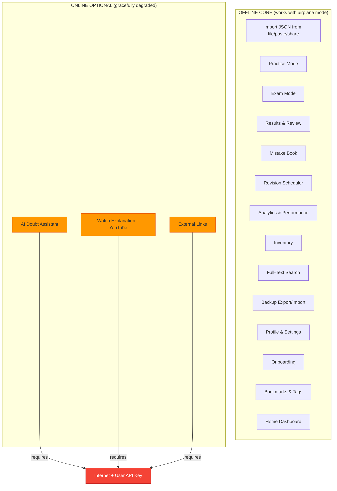
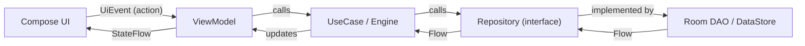
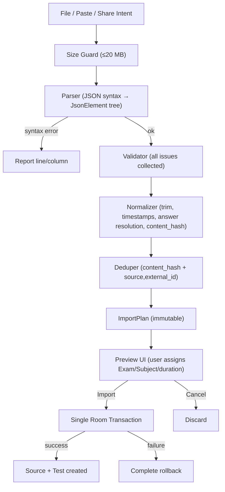
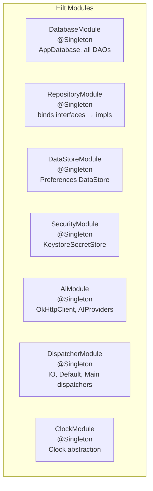
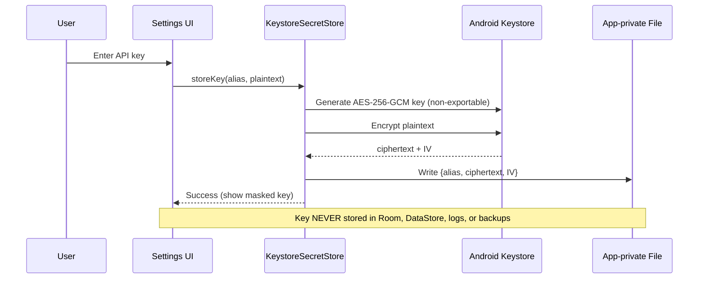

# Architecture — AptiVilla

> **Version:** 1.0 · Phase 0 · Last updated: 2026-09-29

---

## 1. Guiding Principles

| Principle | Implication |
|---|---|
| **Offline-first** | Every feature except AI chat and external links works without internet. The local Room database is the single source of truth. |
| **Student owns the data** | No accounts, no telemetry, no server. Export/import is the backup & portability mechanism. |
| **Deterministic content pipeline** | JSON import is pure software — parse, validate, normalize, preview, save. No AI involved. |
| **Honest statistics** | All numbers derive from real attempt data via SQL. No AI-generated scores or fabricated judgments. |
| **AI is optional & user-triggered** | The app is a complete product at Phase 8 with zero AI. AI (Phase 9) is an add-on doubt assistant using the student's own API key. |
| **Low-end friendly** | Target: 2 GB RAM devices common among Indian students. Small APK (<25 MB), Paging for lists, indexed queries, no heavy libraries. |

---

## 2. Layered Architecture

```
┌───────────────────────────────────────────────────────────────┐
│                        UI / Feature Layer                      │
│  Jetpack Compose screens, ViewModels (StateFlow<UiState>)     │
│  feature.home, feature.practice, feature.test, feature.review,│
│  feature.analytics, feature.importer, feature.search, ...     │
│  feature.ai (ONLY feature that may observe connectivity)      │
└────────────────────────────┬──────────────────────────────────┘
                             │ UiEvent ↑  StateFlow<UiState> ↓
┌────────────────────────────┴──────────────────────────────────┐
│                        Domain Layer                            │
│  PURE KOTLIN — no Android, no Room, no OkHttp imports         │
│  domain.model, domain.repository (interfaces),                │
│  domain.importer (parser, validator, normalizer),             │
│  domain.engine.test, domain.engine.hint,                      │
│  domain.engine.performance, domain.engine.revision,           │
│  domain.usecase, domain.backup                                │
└────────────────────────────┬──────────────────────────────────┘
                             │ Repository interfaces
┌────────────────────────────┴──────────────────────────────────┐
│                        Data Layer                              │
│  data.local (Room DB, DAOs, entities, FTS, migrations)        │
│  data.repository (Room-backed implementations)                │
│  data.backup (ZIP + NDJSON via SAF)                           │
│  data.prefs (Jetpack DataStore — non-secret settings)         │
│  data.secure (Android Keystore secret store)                  │
└───────────────────────────────────────────────────────────────┘

┌───────────────────────────────────────────────────────────────┐
│                     AI Layer (network-capable)                 │
│  ai.provider (AIProvider interface + 3 adapters)              │
│  ai.context (ContextBuilder, AnswerGate, token budget)        │
│  ai.prompt (system prompts)                                   │
│  ai.storage (conversation persistence)                        │
│  ** ONLY code in the app that imports OkHttp / java.net **    │
└───────────────────────────────────────────────────────────────┘
```

### 2.1 Dependency Rules (enforced by architecture tests)

| Source package | May depend on | Must NOT depend on |
|---|---|---|
| `domain.*` | Kotlin stdlib, `kotlinx.serialization` (for `JsonElement` in importer), `java.time`, `core.common` | Android SDK, Room, OkHttp, `java.net.*`, Hilt annotations |
| `data.local.*` | `domain.model`, `domain.repository`, Room, Android SDK | OkHttp, `java.net.*`, `ai.*`, `feature.*` |
| `data.repository.*` | `domain.*`, `data.local.*` | OkHttp, `java.net.*`, `ai.*`, `feature.*` |
| `feature.*` (except `feature.ai`) | `domain.*`, `core.*`, Compose, Hilt | Room entities directly, OkHttp, `java.net.*`, `ai.*` |
| `feature.ai` | `domain.*`, `ai.*`, `core.*`, Compose, Hilt | Room entities directly, `data.local.*` |
| `ai.*` | `domain.model` (read-only models), OkHttp, `kotlinx.serialization`, Keystore | Room, `data.local.*`, `feature.*` |

### 2.2 Network Isolation Rule

> **Only the `ai` package and the "open external link" utility (`core.common.ExternalLinkLauncher`) may access the network.**

This is enforced by a Konsist architecture test that asserts:
- No class outside `ai.*` imports `okhttp3.*`, `java.net.*`, `javax.net.*`, `android.net.ConnectivityManager` (except a connectivity observer used only to gate AI/link UI).
- No class in `domain.*`, `data.local.*`, `data.repository.*`, `data.backup.*`, `data.prefs.*` imports any network class.

---

## 3. Module Structure

**Single Gradle module `:app`** with package-by-feature organization (Decision D16). Boundaries enforced by architecture tests, not Gradle module isolation. Module splitting deferred until build times or team size justify it.

```
app/src/main/java/app/apti/villa/
├─ AptiVillaApp.kt                // @HiltAndroidApp Application
├─ MainActivity.kt                // Single-activity, Compose host
├─ core/
│  ├─ designsystem/               // Theme, Typography, Color, reusable Composables, icons
│  ├─ navigation/                 // Route definitions, NavHost, BottomBar, TopBar
│  ├─ common/                     // Result/Outcome sealed class, Dispatchers provider,
│  │                              // Clock abstraction, time utils, ExternalLinkLauncher,
│  │                              // ConnectivityObserver (only for gating AI/link UI)
│  └─ di/                         // Hilt modules: DatabaseModule, RepositoryModule, etc.
├─ domain/                        // *** PURE KOTLIN ***
│  ├─ model/                      // Question, Test, Attempt, Hint, Trick, Tag, etc.
│  ├─ repository/                 // Interfaces: QuestionRepository, TestRepository, etc.
│  ├─ importer/                   // JsonParser, ContentValidator, ContentNormalizer,
│  │                              // Deduplicator, ImportPlan, ImportIssue, IssueCodes
│  ├─ engine/
│  │  ├─ test/                    // TestSession state machine, TimerPolicy, Scorer
│  │  ├─ hint/                    // HintLadder, HintUsageRecorder
│  │  ├─ performance/             // PerformanceCalculator, formulas, min-sample rules
│  │  ├─ revision/                // LeitnerScheduler, RevisionQueueBuilder
│  │  └─ inventory/               // InventoryAggregator
│  ├─ backup/                     // BackupManifest, BackupSerializer contracts
│  └─ usecase/                    // Use cases bridging engines with repositories
├─ data/
│  ├─ local/
│  │  ├─ db/                      // AppDatabase, TypeConverters, migrations/
│  │  ├─ entity/                  // Room @Entity classes (map to/from domain models)
│  │  ├─ dao/                     // Room @Dao interfaces
│  │  └─ fts/                     // FTS4 entity definitions
│  ├─ repository/                 // Room-backed implementations of domain repositories
│  ├─ backup/                     // ZipBackupWriter, ZipBackupReader (SAF-based)
│  ├─ prefs/                      // DataStore preferences (theme, daily goal, etc.)
│  └─ secure/                     // KeystoreSecretStore (AES-256-GCM key wrapping)
├─ ai/                            // *** ONLY NETWORK-CAPABLE CODE ***
│  ├─ provider/                   // AIProvider interface, OpenAiCompatibleProvider,
│  │                              // GeminiProvider, AnthropicProvider
│  ├─ context/                    // ContextBuilder, AnswerGate, TokenBudget
│  ├─ prompt/                     // System prompt templates
│  └─ storage/                    // AiConversationRepository (local persistence)
└─ feature/
   ├─ onboarding/                 // Name, target exams, daily goal (skippable)
   ├─ home/                       // Dashboard with real data
   ├─ practice/                   // Topic browser, practice hub, filters
   ├─ question/                   // Question screen (practice mode, hints, tricks)
   ├─ test/                       // Test list, test detail, exam screen, results
   ├─ results/                    // Result screen, review mode viewer
   ├─ importer/                   // Import flow UI (source pick, validation, preview)
   ├─ review/                     // Segmented: Mistakes | Revision | Bookmarks
   ├─ analytics/                  // Dashboard, drill-down, charts
   ├─ profile/                    // Profile view/edit
   ├─ inventory/                  // Inventory screens (tests, questions, learning)
   ├─ search/                     // Global search with filters
   ├─ ai/                         // AI chat UI, AI history, provider settings
   └─ settings/                   // Theme, data management, backup, privacy, about
```

---

## 4. Offline-Core vs Online-Optional



### 4.1 Connectivity Handling

- A `ConnectivityObserver` (in `core.common`) monitors network state.
- It is consumed **only** by:
  - `feature.ai` — to show "No internet" state on the AI chat button/screen.
  - `core.common.ExternalLinkLauncher` — to show "Requires internet" when tapping YouTube/external links.
- **No other feature reads or reacts to connectivity state.** The rest of the app is oblivious to network.

### 4.2 Features That Genuinely Require a Backend (NOT built in MVP)

These are documented here for completeness. They require server infrastructure and are planned for V3+:

| Feature | Why it needs a backend |
|---|---|
| Automatic cross-device sync | Needs a central conflict-resolution server |
| Leaderboards / multiplayer | Needs a shared state server |
| Shared / marketplace content discovery | Needs a content server + moderation |
| Teacher dashboards | Needs multi-user server |
| Server push notifications | Needs push infrastructure (FCM) |
| Remote moderation | Needs admin server |
| Remote analytics | Needs analytics server |

**Local-first substitute:** Manual `.aptbackup` file export/import handles device migration and backup.

---

## 5. Data Flow

### 5.1 Unidirectional UI Architecture



Every ViewModel exposes:
- `val uiState: StateFlow<UiState>` — immutable state snapshot
- `fun onEvent(event: UiEvent)` — all user actions dispatched as sealed class events

No UI component ever directly calls a repository or DAO.

### 5.2 Import Data Flow



### 5.3 Future RemoteDataSource Seam

Repositories in `domain/repository` are interfaces. Currently implemented by `data/repository` (local-only). In V3, a `RemoteDataSource` can be added behind the same interfaces:

```kotlin
// domain/repository
interface QuestionRepository {
    fun getQuestions(filter: QuestionFilter): Flow<PagingData<Question>>
    suspend fun upsertQuestion(question: Question)
    // ...
}

// data/repository (current — local only)
class LocalQuestionRepository(
    private val questionDao: QuestionDao
) : QuestionRepository { ... }

// data/repository (V3 — sync-capable)
class SyncQuestionRepository(
    private val local: QuestionDao,
    private val remote: RemoteQuestionDataSource,
    private val syncEngine: SyncEngine
) : QuestionRepository { ... }
```

The `uuid` and `updated_at` fields on all exportable entities make this possible without a schema rewrite.

---

## 6. Dependency Injection (Hilt)



Key DI decisions:
- `AppDatabase` is `@Singleton` — one instance, WAL mode enabled.
- Dispatchers are injected (not hardcoded) for testability.
- `Clock` is injected for deterministic time in tests.
- `OkHttpClient` lives only in `AiModule`, never exposed outside `ai.*`.

---

## 7. Security & Privacy Architecture

### 7.1 API Key Storage



### 7.2 What Never Leaves the Device

- Question content, attempt data, analytics, profile — **never sent anywhere** (no backend, no analytics SDK).
- API keys — never in Room, logs, backups, crash text, or AI request bodies (sent only as `Authorization` header).
- HTTP logging: `Authorization`, `x-api-key`, `key=` headers are redacted. Release builds have no HTTP body logging.

### 7.3 What May Leave the Device (user-triggered only)

| Data | Destination | When |
|---|---|---|
| Question text + options + student answer + conversation | AI provider (user's chosen endpoint) | User taps "Ask AI" |
| `.aptbackup` file | User-chosen storage via SAF | User taps "Export" |
| YouTube URL | YouTube app/browser | User taps "Watch Explanation" |

---

## 8. Threading & Concurrency

- All Room queries return `Flow<T>` (for observation) or `suspend` functions (for writes).
- Multi-row writes that must be consistent use a single `@Transaction`.
- No blocking calls on the main thread.
- Dispatchers are injected: `@IoDispatcher`, `@DefaultDispatcher`, `@MainDispatcher`.
- Test/practice auto-save runs on IO dispatcher, debounced to avoid excessive writes.
- Timer uses `System.nanoTime()` deltas (monotonic), not wall clock.

---

## 9. Error Handling Strategy

All operations use a sealed `Outcome<T>` type:

```kotlin
sealed interface Outcome<out T> {
    data class Success<T>(val data: T) : Outcome<T>
    data class Error(val error: AppError) : Outcome<Nothing>
}

sealed interface AppError {
    data class Import(val issues: List<ImportIssue>) : AppError
    data class Database(val cause: Throwable) : AppError
    data class Ai(val code: AiErrorCode, val message: String) : AppError
    data class Keystore(val cause: Throwable) : AppError
    // ...
}
```

ViewModels map `AppError` → user-friendly messages via `strings.xml`. No raw exceptions shown to users.

---

## 10. Build & Release

- **Gradle Kotlin DSL** with `libs.versions.toml` for all dependency versions.
- **KSP** (not kapt) for Hilt and Room annotation processing.
- **R8 minification + resource shrinking** on release builds.
- **Baseline Profile** added in Phase 10 for optimized startup.
- Room `exportSchema = true`, schema JSON committed to `app/schemas/`.
- `applicationId = "app.apti.villa"` defined in one place (`build.gradle.kts`).
- App name "AptiVilla" defined in `strings.xml` as `app_name` — trivial to change.
