# Database Design — AptiVilla

> **Version:** 1 (Room schema version 1) · Phase 0 · Last updated: 2026-09-29

---

## 1. Conventions

| Convention | Detail |
|---|---|
| Primary key | `id INTEGER PRIMARY KEY AUTOINCREMENT` (local, never exported as identity) |
| External identity | `uuid TEXT NOT NULL UNIQUE` (UUIDv4, generated on creation, stable across export/import) |
| Timestamps | `created_at INTEGER NOT NULL`, `updated_at INTEGER NOT NULL` — epoch milliseconds (UTC) |
| Foreign keys | `PRAGMA foreign_keys = ON`. Owned children use `ON DELETE CASCADE`. |
| Enums | Stored as `TEXT` (Room `@TypeConverter` not needed; use string columns). |
| Nullability | Nullable columns are explicitly marked. Everything else is `NOT NULL`. |
| Naming | `snake_case` tables and columns. Junction tables: `parent_child`. |
| WAL | Enabled via `AppDatabase.Builder.setJournalMode(JournalMode.WRITE_AHEAD_LOGGING)` |

---

## 2. Entity-Relationship Diagram

```mermaid
erDiagram
    EXAM {
        int id PK
        text uuid UK
        text name UK
        bool is_builtin
        int sort_order
        int created_at
        int updated_at
    }

    SUBJECT {
        int id PK
        text name UK
        int created_at
        int updated_at
    }

    TOPIC {
        int id PK
        int subject_id FK "nullable"
        text name
        int created_at
        int updated_at
    }

    SUB_TOPIC {
        int id PK
        int topic_id FK
        text name
        int created_at
        int updated_at
    }

    SOURCE {
        int id PK
        text uuid UK
        text title
        text type "JSON|YOUTUBE|MANUAL|OTHER"
        text url "nullable"
        text channel "nullable"
        int schema_version
        text content_hash
        int imported_at
        text import_report_json "nullable"
        int created_at
        int updated_at
    }

    TEST {
        int id PK
        text uuid UK
        int source_id FK "nullable"
        int exam_id FK "nullable"
        text title
        text kind "IMPORTED|CUSTOM|MOCK|PRACTICE_SET|TOPIC|REVISION"
        int duration_sec "nullable"
        real marks_correct "default 1"
        real negative_marks "default 0"
        bool archived "default 0"
        int created_at
        int updated_at
    }

    QUESTION {
        int id PK
        text uuid UK
        int source_id FK
        text external_id
        text content_hash
        text text
        text format "MCQ_SINGLE"
        int subject_id FK "nullable"
        int topic_id FK "nullable"
        int sub_topic_id FK "nullable"
        text difficulty "nullable: EASY|MEDIUM|HARD"
        int source_timestamp_sec "nullable"
        text source_url "nullable"
        text language "nullable"
        bool has_solution
        int created_at
        int updated_at
    }

    TEST_QUESTION {
        int test_id FK, PK
        int question_id FK, PK
        int position
    }

    QUESTION_OPTION {
        int id PK
        int question_id FK
        int position
        text text
        bool is_correct
    }

    HINT {
        int id PK
        int question_id FK
        int number
        text title
        text description
    }

    TRICK {
        int id PK
        int question_id FK
        text name
        text description
    }

    SOLUTION_STEP {
        int id PK
        int question_id FK
        int number
        text action
    }

    ATTEMPT {
        int id PK
        text uuid UK
        int test_id FK "nullable"
        text mode "PRACTICE|EXAM|REVIEW"
        text scope_desc "nullable"
        text status "IN_PROGRESS|PAUSED|SUBMITTED|ABANDONED"
        int started_at
        int submitted_at "nullable"
        int time_limit_sec "nullable"
        int active_elapsed_ms
        real score "nullable"
        bool is_retry
        int created_at
        int updated_at
    }

    ANSWER {
        int id PK
        int attempt_id FK
        int question_id FK
        int position
        text status "UNSEEN|SEEN|ANSWERED|SKIPPED|MARKED|ANSWERED_MARKED"
        int selected_option_id FK "nullable"
        bool is_correct "nullable"
        int time_spent_ms
        int first_seen_at "nullable"
        int answered_at "nullable"
        bool first_submission_correct "nullable"
        int hints_opened "default 0"
        int solved_at_hint_level "nullable"
        bool revealed "default 0"
    }

    ANSWER_SUBMISSION {
        int id PK
        int answer_id FK
        int option_id FK
        int submitted_at
        int hints_open_at_submit
        int ms_since_first_seen
        bool is_correct
    }

    HINT_USAGE {
        int id PK
        int answer_id FK
        int hint_id FK
        int opened_at
        int ms_since_first_seen
    }

    TAG {
        int id PK
        text uuid UK
        text name UK
        text color "nullable"
        bool is_system
        int created_at
        int updated_at
    }

    QUESTION_TAG {
        int question_id FK, PK
        int tag_id FK, PK
        int created_at
    }

    SAVED_TRICK {
        int trick_id FK, PK
        int created_at
    }

    MISTAKE {
        int question_id FK, PK
        int first_wrong_at
        int last_wrong_at
        int wrong_count
        int consecutive_correct
        text status "ACTIVE|RESOLVED|REMOVED"
    }

    REVISION_ITEM {
        int question_id FK, PK
        int box
        int due_at
        int last_reviewed_at "nullable"
        int review_count
        bool suspended
    }

    REVISION_REASON {
        int question_id FK, PK
        text reason PK "WRONG|DIFFICULT|MULTI_HINT|BOOKMARKED|MANUAL"
        int created_at
    }

    STUDY_DAY {
        text date PK "YYYY-MM-DD"
        int questions_attempted
        int correct
        int active_ms
    }

    USER_PROFILE {
        int id PK "always 1"
        text name "nullable"
        text preferred_difficulty "nullable"
        int daily_goal_questions "default 20"
        int daily_goal_minutes "default 30"
        text prep_start_date "nullable"
        text target_exam_date "nullable"
        int created_at
        int updated_at
    }

    USER_PROFILE_EXAM {
        int exam_id FK, PK
    }

    USER_PROFILE_SUBJECT {
        int subject_id FK, PK
    }

    AI_PROVIDER_CONFIG {
        int id PK
        text type "OPENAI_COMPATIBLE|GEMINI|ANTHROPIC"
        text display_name
        text base_url "nullable"
        text model
        text key_alias
        bool is_default
        int created_at
        int updated_at
    }

    AI_CONVERSATION {
        int id PK
        text uuid UK
        int question_id FK "nullable"
        text title
        int provider_id FK "nullable"
        int created_at
        int updated_at
    }

    AI_MESSAGE {
        int id PK
        int conversation_id FK "CASCADE"
        text role "USER|ASSISTANT"
        text content
        int created_at
    }

    %% Relationships
    SUBJECT ||--o{ TOPIC : "has"
    TOPIC ||--o{ SUB_TOPIC : "has"
    SOURCE ||--o{ QUESTION : "imported"
    SOURCE ||--o{ TEST : "created from"
    EXAM ||--o{ TEST : "tagged"
    TEST ||--o{ TEST_QUESTION : "contains"
    QUESTION ||--o{ TEST_QUESTION : "appears in"
    QUESTION ||--o{ QUESTION_OPTION : "has"
    QUESTION ||--o{ HINT : "has"
    QUESTION ||--o{ TRICK : "has"
    QUESTION ||--o{ SOLUTION_STEP : "has"
    QUESTION }o--o| SUBJECT : "classified"
    QUESTION }o--o| TOPIC : "classified"
    QUESTION }o--o| SUB_TOPIC : "classified"
    ATTEMPT }o--o| TEST : "for"
    ATTEMPT ||--o{ ANSWER : "contains"
    ANSWER }o--|| QUESTION : "for"
    ANSWER ||--o{ ANSWER_SUBMISSION : "submissions"
    ANSWER ||--o{ HINT_USAGE : "hints opened"
    TAG ||--o{ QUESTION_TAG : "applied"
    QUESTION ||--o{ QUESTION_TAG : "tagged"
    TRICK ||--o| SAVED_TRICK : "saved"
    QUESTION ||--o| MISTAKE : "mistake for"
    QUESTION ||--o| REVISION_ITEM : "revision for"
    QUESTION ||--o{ REVISION_REASON : "reasons"
    EXAM ||--o{ USER_PROFILE_EXAM : "selected"
    SUBJECT ||--o{ USER_PROFILE_SUBJECT : "selected"
    AI_PROVIDER_CONFIG ||--o{ AI_CONVERSATION : "used by"
    AI_CONVERSATION ||--o{ AI_MESSAGE : "contains"
    QUESTION ||--o{ AI_CONVERSATION : "about"
```



---

## 3. Table Details

### 3.1 Taxonomy & Content

#### `exam`
| Column | Type | Constraints | Notes |
|---|---|---|---|
| `id` | INTEGER | PK AUTOINCREMENT | |
| `uuid` | TEXT | NOT NULL UNIQUE | |
| `name` | TEXT | NOT NULL UNIQUE | e.g. "SSC CGL", "IBPS PO" |
| `is_builtin` | INTEGER (bool) | NOT NULL DEFAULT 0 | Seeded rows = 1 |
| `sort_order` | INTEGER | NOT NULL DEFAULT 0 | Display ordering |
| `created_at` | INTEGER | NOT NULL | Epoch ms |
| `updated_at` | INTEGER | NOT NULL | Epoch ms |

**Seeded exams:** SSC CGL, SSC CHSL, SSC MTS, SSC CPO, SSC Steno, IBPS PO, IBPS Clerk, IBPS SO, SBI PO, SBI Clerk, RBI Grade B, RBI Assistant, NIACL AO, LIC AAO, LIC ADO, RRB NTPC, RRB Group D, RRB ALP, RRB JE, NDA, CDS, AFCAT, UPSC CSAT, State PSC, CAT, MAT, XAT, GATE, Placement Aptitude, Custom.

#### `subject`
| Column | Type | Constraints |
|---|---|---|
| `id` | INTEGER | PK AUTOINCREMENT |
| `name` | TEXT | NOT NULL UNIQUE |
| `created_at` | INTEGER | NOT NULL |
| `updated_at` | INTEGER | NOT NULL |

**Note:** No `uuid` — subjects are matched by name across imports. If a future sync layer needs it, a migration can add it.

**Deviation from §6:** Removed `uuid` from `subject`, `topic`, `sub_topic` since taxonomy is matched by name (not identity). This saves storage and simplifies import upserts. Documented in DECISIONS.md as D18.

#### `topic`
| Column | Type | Constraints |
|---|---|---|
| `id` | INTEGER | PK AUTOINCREMENT |
| `subject_id` | INTEGER | FK → `subject(id)` ON DELETE SET NULL, NULLABLE |
| `name` | TEXT | NOT NULL |
| `created_at` | INTEGER | NOT NULL |
| `updated_at` | INTEGER | NOT NULL |

**Unique constraint:** `UNIQUE(subject_id, name)` — same topic name can exist under different subjects (or unassigned).

#### `sub_topic`
| Column | Type | Constraints |
|---|---|---|
| `id` | INTEGER | PK AUTOINCREMENT |
| `topic_id` | INTEGER | FK → `topic(id)` ON DELETE CASCADE, NOT NULL |
| `name` | TEXT | NOT NULL |
| `created_at` | INTEGER | NOT NULL |
| `updated_at` | INTEGER | NOT NULL |

**Unique constraint:** `UNIQUE(topic_id, name)`

#### `source`
| Column | Type | Constraints | Notes |
|---|---|---|---|
| `id` | INTEGER | PK AUTOINCREMENT | |
| `uuid` | TEXT | NOT NULL UNIQUE | |
| `title` | TEXT | NOT NULL | From `source_metadata.title` |
| `type` | TEXT | NOT NULL | JSON, YOUTUBE, MANUAL, OTHER |
| `url` | TEXT | NULLABLE | `source_metadata.source_url` |
| `channel` | TEXT | NULLABLE | YouTube channel name |
| `schema_version` | INTEGER | NOT NULL | JSON format version |
| `content_hash` | TEXT | NOT NULL | SHA-256 of entire JSON input |
| `imported_at` | INTEGER | NOT NULL | Epoch ms |
| `import_report_json` | TEXT | NULLABLE | JSON blob of import warnings/skipped |
| `created_at` | INTEGER | NOT NULL | |
| `updated_at` | INTEGER | NOT NULL | |

#### `test`
| Column | Type | Constraints | Notes |
|---|---|---|---|
| `id` | INTEGER | PK AUTOINCREMENT | |
| `uuid` | TEXT | NOT NULL UNIQUE | |
| `source_id` | INTEGER | FK → `source(id)` ON DELETE SET NULL, NULLABLE | |
| `exam_id` | INTEGER | FK → `exam(id)` ON DELETE SET NULL, NULLABLE | User-assigned at import |
| `title` | TEXT | NOT NULL | |
| `kind` | TEXT | NOT NULL | IMPORTED, CUSTOM, MOCK, PRACTICE_SET, TOPIC, REVISION |
| `duration_sec` | INTEGER | NULLABLE | NULL = untimed |
| `marks_correct` | REAL | NOT NULL DEFAULT 1.0 | |
| `negative_marks` | REAL | NOT NULL DEFAULT 0.0 | |
| `archived` | INTEGER (bool) | NOT NULL DEFAULT 0 | |
| `created_at` | INTEGER | NOT NULL | |
| `updated_at` | INTEGER | NOT NULL | |

**Indexes:** `(source_id)`, `(exam_id)`, `(kind)`, `(archived)`

#### `question`
| Column | Type | Constraints | Notes |
|---|---|---|---|
| `id` | INTEGER | PK AUTOINCREMENT | |
| `uuid` | TEXT | NOT NULL UNIQUE | |
| `source_id` | INTEGER | FK → `source(id)` ON DELETE CASCADE, NOT NULL | |
| `external_id` | TEXT | NOT NULL | From JSON `id` field (string) |
| `content_hash` | TEXT | NOT NULL | SHA-256(normalized text + sorted options) |
| `text` | TEXT | NOT NULL | Question text |
| `format` | TEXT | NOT NULL DEFAULT 'MCQ_SINGLE' | Future: MCQ_MULTI, TRUE_FALSE, etc. |
| `subject_id` | INTEGER | FK → `subject(id)` ON DELETE SET NULL, NULLABLE | |
| `topic_id` | INTEGER | FK → `topic(id)` ON DELETE SET NULL, NULLABLE | |
| `sub_topic_id` | INTEGER | FK → `sub_topic(id)` ON DELETE SET NULL, NULLABLE | |
| `difficulty` | TEXT | NULLABLE | EASY, MEDIUM, HARD |
| `source_timestamp_sec` | INTEGER | NULLABLE | Parsed from HH:MM:SS |
| `source_url` | TEXT | NULLABLE | Per-question URL override |
| `language` | TEXT | NULLABLE | ISO 639-1 (e.g. "en", "hi") |
| `has_solution` | INTEGER (bool) | NOT NULL DEFAULT 0 | |
| `created_at` | INTEGER | NOT NULL | |
| `updated_at` | INTEGER | NOT NULL | |

**Unique constraint:** `UNIQUE(source_id, external_id)`
**Indexes:** `(content_hash)`, `(topic_id)`, `(sub_topic_id)`, `(difficulty)`, `(subject_id)`

#### `test_question`
| Column | Type | Constraints |
|---|---|---|
| `test_id` | INTEGER | FK → `test(id)` ON DELETE CASCADE, NOT NULL |
| `question_id` | INTEGER | FK → `question(id)` ON DELETE CASCADE, NOT NULL |
| `position` | INTEGER | NOT NULL |

**Primary key:** `(test_id, question_id)`

#### `question_option`
| Column | Type | Constraints | Notes |
|---|---|---|---|
| `id` | INTEGER | PK AUTOINCREMENT | |
| `question_id` | INTEGER | FK → `question(id)` ON DELETE CASCADE, NOT NULL | |
| `position` | INTEGER | NOT NULL | 0-indexed |
| `text` | TEXT | NOT NULL | |
| `is_correct` | INTEGER (bool) | NOT NULL DEFAULT 0 | Exactly 1 per question (enforced in code + tests) |

**Unique constraint:** `UNIQUE(question_id, position)`
**Index:** `(question_id)`

#### `hint`
| Column | Type | Constraints |
|---|---|---|
| `id` | INTEGER | PK AUTOINCREMENT |
| `question_id` | INTEGER | FK → `question(id)` ON DELETE CASCADE, NOT NULL |
| `number` | INTEGER | NOT NULL |
| `title` | TEXT | NOT NULL |
| `description` | TEXT | NOT NULL |

**Unique constraint:** `UNIQUE(question_id, number)`

#### `trick`
| Column | Type | Constraints |
|---|---|---|
| `id` | INTEGER | PK AUTOINCREMENT |
| `question_id` | INTEGER | FK → `question(id)` ON DELETE CASCADE, NOT NULL |
| `name` | TEXT | NOT NULL |
| `description` | TEXT | NOT NULL |

#### `solution_step`
| Column | Type | Constraints |
|---|---|---|
| `id` | INTEGER | PK AUTOINCREMENT |
| `question_id` | INTEGER | FK → `question(id)` ON DELETE CASCADE, NOT NULL |
| `number` | INTEGER | NOT NULL |
| `action` | TEXT | NOT NULL |

**Unique constraint:** `UNIQUE(question_id, number)`

### 3.2 Attempts

#### `attempt`
| Column | Type | Constraints | Notes |
|---|---|---|---|
| `id` | INTEGER | PK AUTOINCREMENT | |
| `uuid` | TEXT | NOT NULL UNIQUE | |
| `test_id` | INTEGER | FK → `test(id)` ON DELETE SET NULL, NULLABLE | NULL for ad-hoc practice |
| `mode` | TEXT | NOT NULL | PRACTICE, EXAM, REVIEW |
| `scope_desc` | TEXT | NULLABLE | Human label, e.g. "Percentage — Easy — 10 Qs" |
| `status` | TEXT | NOT NULL | IN_PROGRESS, PAUSED, SUBMITTED, ABANDONED |
| `started_at` | INTEGER | NOT NULL | Epoch ms |
| `submitted_at` | INTEGER | NULLABLE | |
| `time_limit_sec` | INTEGER | NULLABLE | NULL = untimed |
| `active_elapsed_ms` | INTEGER | NOT NULL DEFAULT 0 | Monotonic accumulated active time |
| `score` | REAL | NULLABLE | Computed at submission |
| `is_retry` | INTEGER (bool) | NOT NULL DEFAULT 0 | True for retry/revision attempts |
| `created_at` | INTEGER | NOT NULL | |
| `updated_at` | INTEGER | NOT NULL | |

**Indexes:** `(status)`, `(submitted_at)`, `(test_id)`, `(mode)`

#### `answer`
| Column | Type | Constraints | Notes |
|---|---|---|---|
| `id` | INTEGER | PK AUTOINCREMENT | |
| `attempt_id` | INTEGER | FK → `attempt(id)` ON DELETE CASCADE, NOT NULL | |
| `question_id` | INTEGER | FK → `question(id)` ON DELETE CASCADE, NOT NULL | |
| `position` | INTEGER | NOT NULL | Question position in this attempt |
| `status` | TEXT | NOT NULL DEFAULT 'UNSEEN' | UNSEEN, SEEN, ANSWERED, SKIPPED, MARKED, ANSWERED_MARKED |
| `selected_option_id` | INTEGER | FK → `question_option(id)` ON DELETE SET NULL, NULLABLE | |
| `is_correct` | INTEGER (bool) | NULLABLE | NULL if not answered |
| `time_spent_ms` | INTEGER | NOT NULL DEFAULT 0 | |
| `first_seen_at` | INTEGER | NULLABLE | Epoch ms |
| `answered_at` | INTEGER | NULLABLE | |
| `first_submission_correct` | INTEGER (bool) | NULLABLE | Set on first submission only |
| `hints_opened` | INTEGER | NOT NULL DEFAULT 0 | |
| `solved_at_hint_level` | INTEGER | NULLABLE | 0..N, set on first correct submission |
| `revealed` | INTEGER (bool) | NOT NULL DEFAULT 0 | True if "Show answer" used without correct submission |

**Unique constraint:** `UNIQUE(attempt_id, question_id)`
**Indexes:** `(question_id)`, `(is_correct)`, `(attempt_id)`

#### `answer_submission`
| Column | Type | Constraints |
|---|---|---|
| `id` | INTEGER | PK AUTOINCREMENT |
| `answer_id` | INTEGER | FK → `answer(id)` ON DELETE CASCADE, NOT NULL |
| `option_id` | INTEGER | FK → `question_option(id)` ON DELETE CASCADE, NOT NULL |
| `submitted_at` | INTEGER | NOT NULL |
| `hints_open_at_submit` | INTEGER | NOT NULL |
| `ms_since_first_seen` | INTEGER | NOT NULL |
| `is_correct` | INTEGER (bool) | NOT NULL |

**Index:** `(answer_id)`

#### `hint_usage`
| Column | Type | Constraints |
|---|---|---|
| `id` | INTEGER | PK AUTOINCREMENT |
| `answer_id` | INTEGER | FK → `answer(id)` ON DELETE CASCADE, NOT NULL |
| `hint_id` | INTEGER | FK → `hint(id)` ON DELETE CASCADE, NOT NULL |
| `opened_at` | INTEGER | NOT NULL |
| `ms_since_first_seen` | INTEGER | NOT NULL |

**Unique constraint:** `UNIQUE(answer_id, hint_id)`

### 3.3 Learning State

#### `tag`
| Column | Type | Constraints | Notes |
|---|---|---|---|
| `id` | INTEGER | PK AUTOINCREMENT | |
| `uuid` | TEXT | NOT NULL UNIQUE | |
| `name` | TEXT | NOT NULL UNIQUE | |
| `color` | TEXT | NULLABLE | Hex color |
| `is_system` | INTEGER (bool) | NOT NULL DEFAULT 0 | |
| `created_at` | INTEGER | NOT NULL | |
| `updated_at` | INTEGER | NOT NULL | |

**Seeded system tags:** Important, Revise Later, Useful Trick, Difficult, Suspected Wrong Key

#### `question_tag`
| Column | Type | Constraints |
|---|---|---|
| `question_id` | INTEGER | FK → `question(id)` ON DELETE CASCADE, NOT NULL |
| `tag_id` | INTEGER | FK → `tag(id)` ON DELETE CASCADE, NOT NULL |
| `created_at` | INTEGER | NOT NULL |

**Primary key:** `(question_id, tag_id)`

#### `saved_trick`
| Column | Type | Constraints |
|---|---|---|
| `trick_id` | INTEGER | FK → `trick(id)` ON DELETE CASCADE, PK |
| `created_at` | INTEGER | NOT NULL |

#### `mistake`
| Column | Type | Constraints | Notes |
|---|---|---|---|
| `question_id` | INTEGER | FK → `question(id)` ON DELETE CASCADE, PK | |
| `first_wrong_at` | INTEGER | NOT NULL | Epoch ms |
| `last_wrong_at` | INTEGER | NOT NULL | |
| `wrong_count` | INTEGER | NOT NULL DEFAULT 1 | |
| `consecutive_correct` | INTEGER | NOT NULL DEFAULT 0 | Resets on wrong; 2 consecutive correct → RESOLVED |
| `status` | TEXT | NOT NULL DEFAULT 'ACTIVE' | ACTIVE, RESOLVED, REMOVED |

#### `revision_item`
| Column | Type | Constraints | Notes |
|---|---|---|---|
| `question_id` | INTEGER | FK → `question(id)` ON DELETE CASCADE, PK | |
| `box` | INTEGER | NOT NULL DEFAULT 0 | Leitner box 0–5 |
| `due_at` | INTEGER | NOT NULL | Epoch ms |
| `last_reviewed_at` | INTEGER | NULLABLE | |
| `review_count` | INTEGER | NOT NULL DEFAULT 0 | |
| `suspended` | INTEGER (bool) | NOT NULL DEFAULT 0 | |

**Index:** `(due_at)`, `(box)`

#### `revision_reason`
| Column | Type | Constraints |
|---|---|---|
| `question_id` | INTEGER | FK → `question(id)` ON DELETE CASCADE, NOT NULL |
| `reason` | TEXT | NOT NULL |
| `created_at` | INTEGER | NOT NULL |

**Primary key:** `(question_id, reason)`
**Valid reasons:** WRONG, DIFFICULT, MULTI_HINT, BOOKMARKED, MANUAL

#### `study_day`
| Column | Type | Constraints | Notes |
|---|---|---|---|
| `date` | TEXT | PK | Format: YYYY-MM-DD (local timezone) |
| `questions_attempted` | INTEGER | NOT NULL DEFAULT 0 | |
| `correct` | INTEGER | NOT NULL DEFAULT 0 | |
| `active_ms` | INTEGER | NOT NULL DEFAULT 0 | |

### 3.4 Profile

#### `user_profile`
| Column | Type | Constraints |
|---|---|---|
| `id` | INTEGER | PK, always 1 |
| `name` | TEXT | NULLABLE |
| `preferred_difficulty` | TEXT | NULLABLE |
| `daily_goal_questions` | INTEGER | NOT NULL DEFAULT 20 |
| `daily_goal_minutes` | INTEGER | NOT NULL DEFAULT 30 |
| `prep_start_date` | TEXT | NULLABLE (YYYY-MM-DD) |
| `target_exam_date` | TEXT | NULLABLE (YYYY-MM-DD) |
| `created_at` | INTEGER | NOT NULL |
| `updated_at` | INTEGER | NOT NULL |

#### `user_profile_exam`
| Column | Type | Constraints |
|---|---|---|
| `exam_id` | INTEGER | FK → `exam(id)` ON DELETE CASCADE, PK |

#### `user_profile_subject`
| Column | Type | Constraints |
|---|---|---|
| `subject_id` | INTEGER | FK → `subject(id)` ON DELETE CASCADE, PK |

### 3.5 AI

#### `ai_provider_config`
| Column | Type | Constraints | Notes |
|---|---|---|---|
| `id` | INTEGER | PK AUTOINCREMENT | |
| `type` | TEXT | NOT NULL | OPENAI_COMPATIBLE, GEMINI, ANTHROPIC |
| `display_name` | TEXT | NOT NULL | |
| `base_url` | TEXT | NULLABLE | For OpenAI-compatible custom endpoints |
| `model` | TEXT | NOT NULL | User-editable, suggested presets |
| `key_alias` | TEXT | NOT NULL | Reference to Keystore entry, NOT the key |
| `is_default` | INTEGER (bool) | NOT NULL DEFAULT 0 | |
| `created_at` | INTEGER | NOT NULL | |
| `updated_at` | INTEGER | NOT NULL | |

**⚠️ No key material is stored in this table.** `key_alias` is a Keystore reference.

#### `ai_conversation`
| Column | Type | Constraints |
|---|---|---|
| `id` | INTEGER | PK AUTOINCREMENT |
| `uuid` | TEXT | NOT NULL UNIQUE |
| `question_id` | INTEGER | FK → `question(id)` ON DELETE SET NULL, NULLABLE |
| `title` | TEXT | NOT NULL |
| `provider_id` | INTEGER | FK → `ai_provider_config(id)` ON DELETE SET NULL, NULLABLE |
| `created_at` | INTEGER | NOT NULL |
| `updated_at` | INTEGER | NOT NULL |

#### `ai_message`
| Column | Type | Constraints |
|---|---|---|
| `id` | INTEGER | PK AUTOINCREMENT |
| `conversation_id` | INTEGER | FK → `ai_conversation(id)` ON DELETE CASCADE, NOT NULL |
| `role` | TEXT | NOT NULL | USER, ASSISTANT |
| `content` | TEXT | NOT NULL |
| `created_at` | INTEGER | NOT NULL |

**Index:** `(conversation_id, created_at)`

---

## 4. Full-Text Search (FTS4)

### 4.1 Strategy

Use Room's `@Fts4` annotation with `unicode61` tokenizer for proper Unicode/Devanagari support.

#### FTS Tables

| FTS Table | Source Table | Indexed Columns | Sync Method |
|---|---|---|---|
| `question_fts` | `question` | `text` | `@Fts4(contentEntity = QuestionEntity::class)`, Room-managed triggers |
| `question_option_fts` | `question_option` | `text` | `@Fts4(contentEntity = QuestionOptionEntity::class)`, Room-managed triggers |
| `trick_fts` | `trick` | `name`, `description` | `@Fts4(contentEntity = TrickEntity::class)`, Room-managed triggers |
| `test_fts` | `test` | `title` | `@Fts4(contentEntity = TestEntity::class)`, Room-managed triggers |

#### Topic/Sub-topic Search

Topics and sub-topics are small enough for LIKE-based prefix matching. No FTS table needed.

### 4.2 Query Strategy

Global search combines results from multiple FTS tables:
```sql
-- Questions matching search term
SELECT q.id, q.text, 'question' AS result_type
FROM question_fts fts
JOIN question q ON q.rowid = fts.rowid
WHERE question_fts MATCH :query

UNION ALL

-- Tests matching search term
SELECT t.id, t.title, 'test' AS result_type
FROM test_fts fts
JOIN test t ON t.rowid = fts.rowid
WHERE test_fts MATCH :query

-- etc. for tricks, options
```

**Performance target:** < 100 ms on 5,000 questions (measured on low-end emulator).

---

## 5. Indexes Summary

| Table | Index | Columns |
|---|---|---|
| `question` | `idx_question_content_hash` | `(content_hash)` |
| `question` | `idx_question_topic` | `(topic_id)` |
| `question` | `idx_question_sub_topic` | `(sub_topic_id)` |
| `question` | `idx_question_difficulty` | `(difficulty)` |
| `question` | `idx_question_subject` | `(subject_id)` |
| `test` | `idx_test_source` | `(source_id)` |
| `test` | `idx_test_exam` | `(exam_id)` |
| `test` | `idx_test_kind` | `(kind)` |
| `attempt` | `idx_attempt_status` | `(status)` |
| `attempt` | `idx_attempt_submitted_at` | `(submitted_at)` |
| `attempt` | `idx_attempt_test` | `(test_id)` |
| `attempt` | `idx_attempt_mode` | `(mode)` |
| `answer` | `idx_answer_question` | `(question_id)` |
| `answer` | `idx_answer_correct` | `(is_correct)` |
| `answer` | `idx_answer_attempt` | `(attempt_id)` |
| `answer_submission` | `idx_submission_answer` | `(answer_id)` |
| `revision_item` | `idx_revision_due` | `(due_at)` |
| `revision_item` | `idx_revision_box` | `(box)` |
| `ai_message` | `idx_ai_message_conv_time` | `(conversation_id, created_at)` |

---

## 6. Migration Strategy

1. **Room `exportSchema = true`**: Schema JSON files committed to `app/schemas/` for every version.
2. **`fallbackToDestructiveMigration` is NEVER used.**
3. Every schema version step has:
   - A `Migration(from, to)` implementation.
   - A `MigrationTestHelper` test verifying data preservation.
4. **Pre-migration safety copy**: Before any migration runs, the app copies the database file to `databases/aptiprep_backup_vN.db`. This is done in the Room callback `onOpen` or via a custom `SupportSQLiteOpenHelper`.
5. **Version 1** = the schema defined in this document.

---

## 7. Performance Formulas

All formulas operate on `attempt` + `answer` data via SQL queries. No caching entity in MVP (Decision D15).

### 7.1 Core Metrics

```
Accuracy = correct / attempted × 100
  where:
    correct  = COUNT(answer WHERE is_correct = 1 AND status IN ('ANSWERED', 'ANSWERED_MARKED'))
    attempted = COUNT(answer WHERE status IN ('ANSWERED', 'ANSWERED_MARKED'))
  Note: skipped/unseen excluded from denominator.

First-attempt accuracy = COUNT(answer WHERE first_submission_correct = 1)
                         / COUNT(answer WHERE first_submission_correct IS NOT NULL)
  Note: Excludes retries (attempt.is_retry = 1) and questions where student never submitted.

Avg time/question = AVG(answer.time_spent_ms) WHERE status IN ('ANSWERED', 'ANSWERED_MARKED')
  Outlier exclusion: time_spent_ms > 600000 (10 min, configurable) → excluded from average.

Median time/question = MEDIAN(answer.time_spent_ms) over same set
  (Computed in Kotlin from sorted list; SQLite lacks native MEDIAN)

Score = (correct × test.marks_correct) − (wrong × test.negative_marks)
  where:
    wrong = attempted − correct
  Applied per-test using that test's marking scheme.

Recent accuracy = accuracy over last 50 attempted answers (overall)
                  or last 20 attempted answers (per topic)

Long-term accuracy = accuracy over ALL attempted answers (all-time)
```

### 7.2 Hint Dependency Distribution

```
For a set of attempted questions (overall or per-topic):
  Solved without hints      = COUNT(answer WHERE solved_at_hint_level = 0 AND is_correct = 1)
  Solved after Hint 1       = COUNT(answer WHERE solved_at_hint_level = 1)
  Solved after Hint 2       = COUNT(answer WHERE solved_at_hint_level = 2)
  Solved after Hint 3+      = COUNT(answer WHERE solved_at_hint_level >= 3)
  Could not solve (revealed) = COUNT(answer WHERE revealed = 1)
```

### 7.3 Topic Metrics

Per topic (and per sub-topic), computed by joining `answer → question → topic`:

```
attempted, correct, incorrect, accuracy, first_attempt_accuracy,
avg_time_ms, median_time_ms, hints_used (SUM hints_opened),
last_practiced (MAX answered_at), revision_count (from revision_item),
difficulty_distribution (GROUP BY question.difficulty)
```

### 7.4 Weak/Strong Classification

```
MIN_SAMPLE = 10  (named constant, configurable)

if attempted_in_topic < MIN_SAMPLE:
    label = "Not enough data ({n}/{MIN_SAMPLE})"
elif recent_accuracy < 60%:
    label = "Weak"
    rank  = (60 - recent_accuracy) * weight(attempted)  // higher = weaker
elif recent_accuracy >= 80%:
    label = "Strong"
else:
    label = "Developing"
```

Weak topics are ranked by `(60% − accuracy)` weighted by attempt count, tie-broken by recency (most recent first).

### 7.5 Streak

```
Streak = count of consecutive calendar days (local timezone) with
         study_day.questions_attempted >= 1, counting backwards from today.

If today has 0 attempts, streak counts from yesterday.
```

### 7.6 Study Day Maintenance

`study_day` is upserted in the same transaction as answer submission:
```sql
INSERT INTO study_day (date, questions_attempted, correct, active_ms)
VALUES (:today, 1, :isCorrect, :timeMs)
ON CONFLICT(date) DO UPDATE SET
  questions_attempted = questions_attempted + 1,
  correct = correct + CASE WHEN :isCorrect THEN 1 ELSE 0 END,
  active_ms = active_ms + :timeMs;
```

---

## 8. Constraints Enforced in Code (not just DB)

| Constraint | Enforcement |
|---|---|
| Exactly 1 `is_correct` option per question | Validator (import), DAO insert transaction (runtime), unit test |
| `hint.number` contiguous 1..N | Validator (import) |
| `solution_step.number` contiguous 1..N | Validator (import) |
| 2–6 options per question | Validator (import), DAO |
| `hint_count` == `hints.length` if present | Validator (import) |
| No duplicate option text per question | Normalizer (after trim/collapse) |
| `answer.selected_option_id` belongs to `answer.question_id` | DAO insert check |
| Attempt status transitions valid | TestSession state machine |
