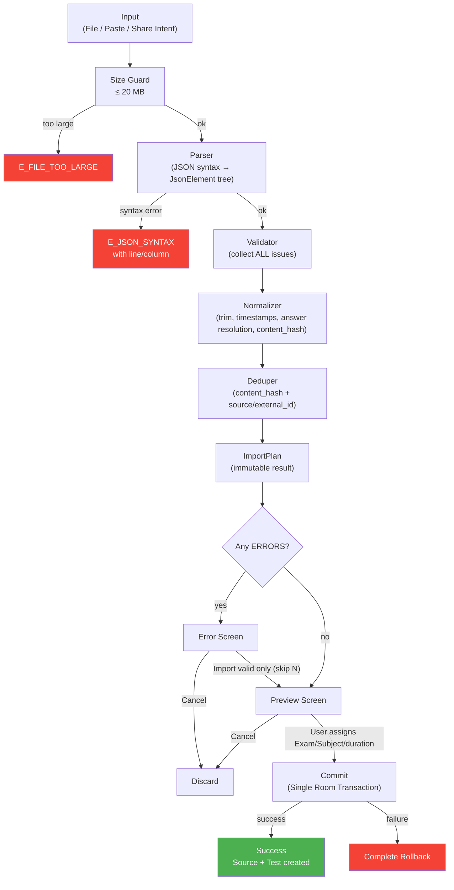

# Import Specification — AptiVilla JSON Content Format v1

> **Version:** 1 · Phase 0 · Last updated: 2026-09-29

---

## 1. Overview

AptiVilla imports aptitude questions from JSON files following this specification. The import pipeline is **entirely deterministic software** — it never calls AI. Content import is local-only and works fully offline.

### Input Methods

| Method | Flow |
|---|---|
| **File picker (SAF)** | User selects a `.json` file from device storage |
| **Paste text** | User pastes JSON text into a text field |
| **Share intent** | User shares a `.json` file from another app |

### Size Limits

| Limit | Value | Behavior |
|---|---|---|
| Max file size | 20 MB | Files > 20 MB are rejected with `E_FILE_TOO_LARGE` |
| Paste warning | > 500 KB | Warn user and suggest file import instead |
| Binder limit | ~1 MB | Share intents with large text use content URI instead |

---

## 2. JSON Schema (v1)

### 2.1 Root Object

| Field | Type | Required | Constraints | Notes |
|---|---|---|---|---|
| `schema_version` | integer | **YES** | Must be `1` | Future versions will have versioned parsers |
| `source_metadata` | object | **YES** | See §2.2 | |
| `questions` | array | **YES** | Non-empty array of question objects | |

### 2.2 `source_metadata` Object

| Field | Type | Required | Constraints | Notes |
|---|---|---|---|---|
| `title` | string | **YES** | Non-empty after trim | Becomes `source.title` and `test.title` |
| `topic` | string | **YES** | Non-empty after trim | Maps to `topic.name` |
| `sub_topic` | string | No | Non-empty after trim if present | Maps to `sub_topic.name` |
| `subject` | string | No | Non-empty after trim if present | Maps to `subject.name`. Also assignable in Preview UI |
| `exam` | string | No | Non-empty after trim if present | Matched against `exam.name` (case-insensitive). Also assignable in Preview UI |
| `source_type` | string | No | One of: `JSON`, `YOUTUBE`, `MANUAL`, `OTHER` | Default: `JSON` |
| `source_url` | string | No | Valid URL if present | e.g., YouTube video URL |
| `channel` | string | No | | YouTube channel name |
| `language` | string | No | ISO 639-1 code | e.g., `en`, `hi` |

### 2.3 `questions[n]` Object

| Field | Type | Required | Constraints | Notes |
|---|---|---|---|---|
| `id` | integer or string | **YES** | Unique within file | Becomes `question.external_id` (always stored as string) |
| `question_text` | string | **YES** | Non-empty after trim | |
| `options` | array of string | **YES** | 2–6 items; each non-empty after trim; no duplicates after normalization | |
| `correct_answer` | string | **YES** | Must match exactly one option (see §3.3) | Resolved to `question_option.is_correct` |
| `timestamp` | string | No | `HH:MM:SS` or `MM:SS` format | Parsed to seconds → `question.source_timestamp_sec` |
| `category` | string | No | Non-empty after trim if present | Fallback for `sub_topic` if `source_metadata.sub_topic` is absent |
| `difficulty` | string | No | One of: `easy`, `medium`, `hard` (case-insensitive) | |
| `hint_count` | integer | No | If present, must equal `hints.length` | |
| `hints` | array | No | Array of hint objects; see §2.4 | |
| `tricks` | array | No | Array of trick objects; see §2.5 | |
| `solution_steps` | array | No | Array of step objects; see §2.6 | |
| `subject` | string | No | | Per-question subject override |
| `exam` | string | No | | Per-question exam tag |

### 2.4 `hints[n]` Object

| Field | Type | Required | Constraints |
|---|---|---|---|
| `hint_number` | integer | **YES** | Must be contiguous 1..N where N = `hints.length` |
| `title` | string | **YES** | Non-empty after trim |
| `description` | string | **YES** | Non-empty after trim |

### 2.5 `tricks[n]` Object

| Field | Type | Required | Constraints |
|---|---|---|---|
| `trick_name` | string | **YES** | Non-empty after trim |
| `description` | string | **YES** | Non-empty after trim |

### 2.6 `solution_steps[n]` Object

| Field | Type | Required | Constraints |
|---|---|---|---|
| `step_number` | integer | **YES** | Must be contiguous 1..N where N = `solution_steps.length` |
| `action` | string | **YES** | Non-empty after trim |

### 2.7 Unknown Fields

Any field not listed above is **allowed** but produces a `W_UNKNOWN_FIELD` warning. Unknown fields are preserved in the import report but not stored in the database.

---

## 3. Import Pipeline

### 3.1 Pipeline Diagram



### 3.2 Pipeline Stage Details

#### Stage 1: Size Guard
- Reject files > 20 MB.
- Warn on pasted text > 500 KB and suggest file import.

#### Stage 2: Parser
- Parse JSON string into `kotlinx.serialization`'s `JsonElement` tree.
- On syntax error: report line number and column (estimated from character offset).
- Produces: `JsonObject` root element.

#### Stage 3: Validator
- Walks the `JsonElement` tree with path-aware traversal.
- **Collects ALL issues** — never stops at the first error.
- Each issue has: `path` (JSON path), `code` (issue code), `severity` (ERROR/WARNING), `questionIndex` (nullable), `questionId` (nullable), `message` (human-readable).
- Validates: required fields, types, constraints, cross-field consistency.

#### Stage 4: Normalizer
- Trims and collapses whitespace in all text fields.
- Parses timestamps: `HH:MM:SS` → seconds, `MM:SS` → seconds.
- Resolves `correct_answer` → option index (see §3.3).
- Computes `content_hash` = SHA-256 of (normalized question text + sorted normalized option texts).
- Normalizes `difficulty` to uppercase enum.
- Normalizes `external_id` to string representation.

#### Stage 5: Deduper
- For each question, checks local database:
  - **By `content_hash`**: exact content duplicate.
  - **By `(source_id, external_id)`**: same source reimport.
- Produces `W_DUPLICATE_OF_EXISTING` warnings with the existing question details.
- User can choose: "Skip duplicates" or "Import anyway".

#### Stage 6: ImportPlan
- Immutable data class summarizing:
  - `validQuestions: List<NormalizedQuestion>`
  - `skippedQuestions: List<SkippedQuestion>` (with reasons)
  - `issues: List<ImportIssue>`
  - `stats: ImportStats` (total, valid, skipped, errors, warnings)
  - `sourceMetadata: NormalizedSourceMetadata`

### 3.3 Correct Answer Resolution

Resolution order (first match wins):

| Step | Match Type | Condition | Result |
|---|---|---|---|
| 1 | **Exact** | `correct_answer` exactly equals an option text | Match |
| 2 | **Trimmed** | After trimming whitespace and collapsing internal whitespace | Match |
| 3 | **Case-insensitive** | After step 2 + lowercasing | Match |
| 4 | **Letter/number mapping** | `correct_answer` is a single letter A–E (or digit 1–5), AND no text match found at steps 1–3 | Map by position (A/1→0, B/2→1, etc.) with `W_ANSWER_LETTER_MAPPED` warning |
| 5 | **Ambiguous** | `correct_answer` matches 2+ options at any step | `E_ANSWER_AMBIGUOUS` error |
| 6 | **No match** | None of the above | `E_ANSWER_NO_MATCH` error |

---

## 4. Issue Code Catalog

### 4.1 Errors (block import unless user explicitly chooses "Import valid only")

| Code | Severity | Condition | Example Message |
|---|---|---|---|
| `E_FILE_TOO_LARGE` | ERROR | Input exceeds 20 MB | "File is too large (25 MB). Maximum size is 20 MB." |
| `E_JSON_SYNTAX` | ERROR | Invalid JSON syntax | "JSON syntax error at line 42, column 15: Unexpected comma." |
| `E_MISSING_FIELD` | ERROR | Required field is absent | "Question #7: Missing required field 'question_text'." |
| `E_WRONG_TYPE` | ERROR | Field has wrong JSON type | "Question #3: 'options' must be an array, got string." |
| `E_DUP_QUESTION_ID` | ERROR | Two questions share the same `id` | "Duplicate question id '5' found at positions 5 and 12." |
| `E_EMPTY_QUESTION_TEXT` | ERROR | `question_text` is empty/whitespace-only after trim | "Question #8: 'question_text' is empty." |
| `E_OPTIONS_COUNT` | ERROR | Options array has < 2 or > 6 items | "Question #2: Expected 2–6 options, got 1." |
| `E_DUP_OPTION` | ERROR | Two options are identical after normalization | "Question #4: Duplicate option 'None of the above' at positions 3 and 4." |
| `E_EMPTY_OPTION` | ERROR | An option is empty/whitespace-only after trim | "Question #6: Option at position 2 is empty." |
| `E_ANSWER_NO_MATCH` | ERROR | `correct_answer` doesn't match any option | "Question #7: correct_answer '35' does not match any option." |
| `E_ANSWER_AMBIGUOUS` | ERROR | `correct_answer` matches 2+ options | "Question #9: correct_answer '30' matches options at positions 2 and 4." |
| `E_HINT_NUMBERING` | ERROR | Hint numbers not contiguous 1..N | "Question #11: Hint numbers are [1, 3] but expected [1, 2]." |
| `E_HINT_COUNT_MISMATCH` | ERROR | `hint_count` ≠ `hints.length` | "Question #5: hint_count is 3 but 2 hints provided." |
| `E_STEP_NUMBERING` | ERROR | Step numbers not contiguous 1..N | "Question #14: Solution step numbers are [1, 2, 4] but expected [1, 2, 3]." |
| `E_BAD_URL` | ERROR | URL field is not a valid URL | "source_metadata.source_url: 'not-a-url' is not a valid URL." |
| `E_BAD_TIMESTAMP` | ERROR | Timestamp doesn't match `HH:MM:SS` or `MM:SS` | "Question #3: timestamp '12:99:00' is invalid (minutes must be 0–59)." |
| `E_UNSUPPORTED_STRUCTURE` | ERROR | Content requires features not in MVP | "Question #15: Contains LaTeX expressions which are not supported in this version." |
| `E_SCHEMA_VERSION` | ERROR | `schema_version` is unsupported | "schema_version 3 is not supported. Please update the app." |

### 4.2 Warnings (import proceeds, but user is informed)

| Code | Severity | Condition | Example Message |
|---|---|---|---|
| `W_UNKNOWN_FIELD` | WARNING | Unrecognized field in JSON | "Question #2: Unknown field 'explanation' will be ignored." |
| `W_ANSWER_LETTER_MAPPED` | WARNING | `correct_answer` is a letter/number mapped by position | "Question #6: correct_answer 'C' mapped to option at position 3 ('30')." |
| `W_NO_HINTS` | WARNING | Question has no hints | "Question #1: No hints provided." |
| `W_NO_SOLUTION` | WARNING | Question has no solution steps | "Question #1: No solution steps provided." |
| `W_DUPLICATE_OF_EXISTING` | WARNING | Question matches existing by content_hash | "Question #4: Duplicate of existing question (id: 142) from source 'Percentage Basics'." |

---

## 5. Error Screen Specification

When the import produces errors:

```
┌─────────────────────────────────────────────────┐
│  ⚠ Import Failed — 3 problems in 3 questions   │
│                                                  │
│  Question #7                                     │
│  correct_answer does not match any option.       │
│                                            [Inspect] │
│                                                  │
│  Question #12                                    │
│  hint_number 3 is missing (gap in 1..3).        │
│                                            [Inspect] │
│                                                  │
│  Question #18                                    │
│  question_text is empty.                         │
│                                            [Inspect] │
│                                                  │
│  ┌─────────────────────────────────────────────┐ │
│  │ Import valid questions only (skip 3)        │ │
│  └─────────────────────────────────────────────┘ │
│  ┌─────────────────────────────────────────────┐ │
│  │                  Cancel                      │ │
│  └─────────────────────────────────────────────┘ │
└─────────────────────────────────────────────────┘
```

**[Inspect]** opens the raw JSON of the offending question, with the failing field highlighted (bold + error color). The question is rendered from the original `JsonElement` node, not the normalized data, since the question may not have been normalizable.

---

## 6. Preview Screen Specification

When validation passes (or user chose "Import valid only"):

```
┌─────────────────────────────────────────────────┐
│  Import Preview                                  │
│                                                  │
│  Title:       Number Series Practice             │
│  Topic:       Number Series                      │
│  Sub-topic:   Double Difference                  │
│  Source:       youtu.be/… (YouTube)               │
│                                                  │
│  Questions:    25  ✓                             │
│  Hints:        20                                │
│  Tricks:       8                                 │
│  Solutions:    25                                │
│                                                  │
│  ⚠ 2 warnings (tap to view)                     │
│                                                  │
│  ─── Assign (optional) ───                       │
│  Exam:        [ SSC CGL        ▾ ]              │
│  Subject:     [ Reasoning      ▾ ]              │
│  Duration:    [ __ min (untimed) ]              │
│  Neg. marks:  [ 0.25           ]                │
│                                                  │
│  ┌─────────────────────────────────────────────┐ │
│  │          Preview Questions                   │ │
│  └─────────────────────────────────────────────┘ │
│  ┌─────────────────────────────────────────────┐ │
│  │            Import Test                       │ │
│  └─────────────────────────────────────────────┘ │
│  ┌─────────────────────────────────────────────┐ │
│  │              Cancel                          │ │
│  └─────────────────────────────────────────────┘ │
└─────────────────────────────────────────────────┘
```

---

## 7. Commit Transaction

The commit stage writes all data in **one Room `@Transaction`**:

1. Upsert `subject` (by name)
2. Upsert `topic` (by subject_id + name)
3. Upsert `sub_topic` (by topic_id + name)
4. Insert `source`
5. Insert `test`
6. For each question:
   - Insert `question`
   - Insert `question_option` rows (2–6)
   - Insert `hint` rows
   - Insert `trick` rows
   - Insert `solution_step` rows
   - Insert `test_question` row
7. FTS tables auto-updated via Room triggers

If any step fails, the entire transaction rolls back. The database remains unchanged.

---

## 8. Video Link Behavior

If a `source_url` is a YouTube URL and a question has a `source_timestamp_sec`:
- Show a **[Watch Explanation ▶]** button on the question screen.
- Tapping it opens: `{source_url}&t={source_timestamp_sec}s` via an external `Intent` (YouTube app or browser).
- **Never download, embed, or redistribute video content.**
- If offline: show "Requires internet connection" message (not an error; just informational).

---

## 9. Test Fixtures (required for Phase 2)

| Fixture File | Purpose |
|---|---|
| `valid_minimal.json` | Minimal valid input: 1 question, required fields only |
| `valid_full.json` | Full input: all optional fields populated, hints, tricks, steps |
| `e_json_syntax.json` | Malformed JSON |
| `e_missing_field.json` | Missing required fields |
| `e_wrong_type.json` | Wrong JSON types |
| `e_dup_question_id.json` | Duplicate question IDs |
| `e_empty_question_text.json` | Empty question text |
| `e_options_count.json` | Too few / too many options |
| `e_dup_option.json` | Duplicate options |
| `e_empty_option.json` | Empty option text |
| `e_answer_no_match.json` | Correct answer matches nothing |
| `e_answer_ambiguous.json` | Correct answer matches multiple options |
| `e_hint_numbering.json` | Non-contiguous hint numbers |
| `e_hint_count_mismatch.json` | hint_count ≠ hints.length |
| `e_step_numbering.json` | Non-contiguous step numbers |
| `e_bad_url.json` | Invalid URL |
| `e_bad_timestamp.json` | Invalid timestamp format |
| `e_unsupported_structure.json` | LaTeX or unsupported content |
| `e_schema_version.json` | Unsupported schema version |
| `mixed_valid_invalid.json` | Mix of valid and invalid questions |
| `duplicate_ids.json` | Duplicate question IDs within file |
| `hindi_content.json` | Full Devanagari/Hindi Unicode content |
| `large_2000_questions.json` | Generated at test time by a utility (not committed) |
| `w_unknown_field.json` | JSON with unknown/extra fields |
| `w_answer_letter.json` | Correct answer as letter A–E |
